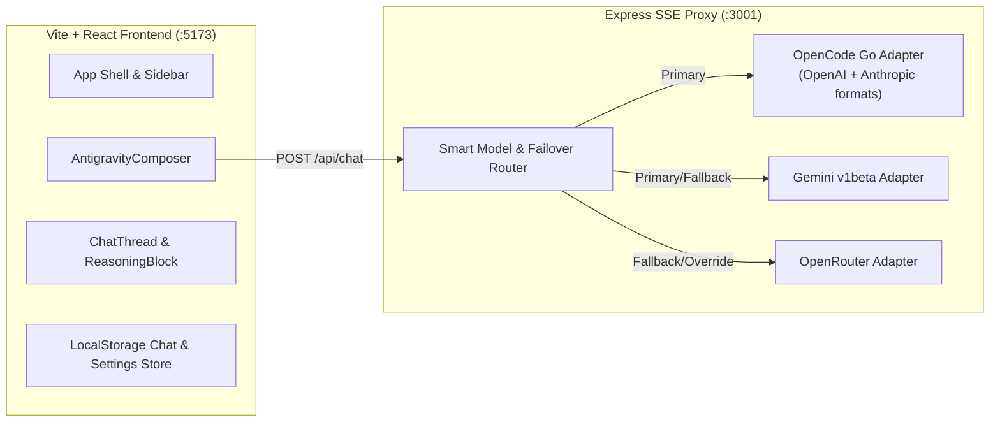

# Arena.ai + Antigravity Direct Chat Clone — Design Specification

**Date:** 2026-10-17  
**Topic:** Arena.ai Direct Chat Clone with Antigravity Composer (`Technical Broadsheet Dark`)  
**Status:** Approved for Planning

---

## 1. Overview & Goals

Build a local-first web application inspired by **Arena.ai**'s hero layout and starter workflow, featuring an **Antigravity-style multi-row composer** in a high-contrast **Technical Broadsheet Dark** aesthetic.

The application supports **Direct Chat** with a single selected model or an intelligent **`Auto` router**, connecting to three provider backends:
1. **OpenCode Go** (`https://opencode.ai/inference/go/openai/v1` and `https://opencode.ai/inference/go/anthropic/v1`)
2. **Google Gemini API** (`https://generativelanguage.googleapis.com/v1beta`)
3. **OpenRouter API** (`https://openrouter.ai/api/v1`)

### Supported Models
1. **`Auto` (Smart Router)** — Selects the optimal model based on prompt intent and attachments
2. **`Beam Free`** (`beam-free` / `reflection/beam-1.0-501b-a23b`)
3. **`DeepSeek V4.1 Flash`** (`deepseek-v4.1-flash` / `deepseek/deepseek-v4.1-flash`)
4. **`GLM-5.3-Flash`** (`glm-5.3-flash` / `z-ai/glm-5.3-flash`)
5. **`Space Bunny`** (`space-bunny` / OpenRouter reasoning fallback)
6. **`Gemini 3.8 Flash`** (`gemini-3.8-flash` / `google/gemini-3.8-flash`)
7. **`Qwen3.8 Flash`** (`qwen3.8-flash` / `qwen/qwen3.8-flash`)

---

## 2. Aesthetic Direction: `Technical Broadsheet Dark`

Newspaper density meets terminal precision — authoritative, high-contrast, zero ornament, and exposed `1px` architectural hairlines.

### 2.1 Color Tokens
| Token | Value | Usage |
| :--- | :--- | :--- |
| `--bg-canvas` | `#09090b` | Primary application background (Zinc 950) |
| `--bg-surface` | `#121215` | Antigravity composer box, starter cards, sidebar, assistant blocks |
| `--bg-elevated` | `#18181c` | Dropdown menus, hover states, code block headers, modals |
| `--border-subtle` | `#27272a` | Default `1px solid` hairline structural rules |
| `--border-strong` | `#52525b` | Hover borders and active pill rules |
| `--border-focus` | `#e4e4e7` | Focused Antigravity composer border |
| `--text-primary` | `#fafafa` | Primary ink (headings, body copy, active inputs) |
| `--text-secondary` | `#a1a1aa` | Secondary labels, starter card descriptions, reasoning text |
| `--text-muted` | `#71717a` | Telemetry timestamps, token counts, placeholders |
| `--signal-ok` | `#10b981` | Active provider status indicator |
| `--signal-warn` | `#f59e0b` | Automatic provider failover notice badge |
| `--signal-danger` | `#ef4444` | Hard error state and active stream Stop button |

### 2.2 Typography & Geometry
- **Display Hero Font:** `'Instrument Serif', Georgia, serif` (`2.5rem` / `40px`, line-height `1.15`, letter-spacing `-0.02em`) for *"What would you like to do?"*
- **Body & Chat Prose Font:** `'Plus Jakarta Sans', -apple-system, BlinkMacSystemFont, sans-serif` (`0.9375rem` / `15px`, line-height `1.65`, comfortable `68ch` measure)
- **Telemetry & Code Font:** `'JetBrains Mono', monospace` (`0.75rem` / `12px`, `font-variant-numeric: tabular-nums`) for model selector pills, provider badges (`[OPENCODE-GO]`, `[GEMINI]`, `[OPENROUTER]`), latency counters, and code blocks
- **Border Radius:** `6px` on outer containers (composer, cards, modals); `4px` on inner pills and buttons
- **Shadows:** `none` — depth and separation are achieved strictly via `1px solid` hairline rules and surface contrast

---

## 3. System Architecture & Units

The project uses a **Vite + React + TypeScript** frontend paired with a lightweight **Node/Express TypeScript API Proxy** (`src/server/`), orchestrated with a single `npm run dev` command.

### 3.1 Backend Modules (`src/server/`)
1. **`config/models.ts` — Model Catalog & Routing Table**
   - Purpose: Defines canonical model metadata, primary provider, fallback provider(s), protocol format (`openai`, `anthropic`, `gemini`), and `Auto` router heuristics.
   - Interface: `resolveModelRoute(modelId, promptText, hasAttachments, providerOverride)`
2. **`providers/opencodeAdapter.ts` — OpenCode Go Stream Adapter**
   - Purpose: Streams from `https://opencode.ai/inference/go/openai/v1/chat/completions` (for `beam-free`, `deepseek-v4.1-flash`, `glm-5.3-flash`, `space-bunny`) and `https://opencode.ai/inference/go/anthropic/v1/messages` (for `qwen3.8-flash`), injecting required `x-opencode-session` and `x-opencode-request` headers.
3. **`providers/geminiAdapter.ts` — Google Gemini Stream Adapter**
   - Purpose: Streams from `https://generativelanguage.googleapis.com/v1beta/models/gemini-3.8-flash:streamGenerateContent?alt=sse&key=...`, extracting both `thought` parts (into `reasoning` deltas) and text parts, plus inline base64 image/file attachments.
4. **`providers/openrouterAdapter.ts` — OpenRouter Stream Adapter**
   - Purpose: Streams from `https://openrouter.ai/api/v1/chat/completions` for `reflection/beam-1.0-501b-a23b`, `deepseek/deepseek-v4.1-flash`, `z-ai/glm-5.3-flash`, `google/gemini-3.8-flash`, and `qwen/qwen3.8-flash`, extracting `delta.reasoning_content` / `delta.reasoning` and `delta.content`.
5. **`routes/chat.ts` — Unified SSE Endpoint (`POST /api/chat`)**
   - Purpose: Attempts the primary provider; if the response status is `401`, `403`, `429`, or `5xx` before content tokens are emitted, emits a structured `failover` SSE event and cascades immediately to the fallback provider.
   - Also exposes `GET /api/providers/status` to verify key validity and return provider readiness to the UI.

### 3.2 Frontend Modules (`src/client/`)
1. **`components/Sidebar.tsx`**
   - Collapsible left rail (`260px` wide) with `+ NEW THREAD`, chronological thread list from `localStorage` (with inline rename and delete), and bottom `[API KEYS & PROVIDERS]` button with live status indicators.
2. **`components/HeroLanding.tsx`**
   - Displayed when active thread has zero messages. Renders the centered `Instrument Serif` heading *"What would you like to do?"*, the centered `AntigravityComposer`, and the *"Get started"* 3×2 starter card grid:
     1. **Create a landing page** — *Create a sleek, modern landing page*
     2. **Build a dashboard** — *Turn data into interactive charts*
     3. **Make a game** — *Build a playable browser game*
     4. **Design to Code** — *Upload an image and have AI build it*
     5. **Build a fullstack app** — *Create a templated full-stack app*
     6. **Launch a storefront** — *Create a beautiful online shop*
3. **`components/AntigravityComposer.tsx`**
   - Multi-row dark composer box with:
     - Attachment preview strip (image thumbnails with remove `×`, text/code file pills showing filename and byte size)
     - Auto-resizing `<textarea>` (`Ask anything...`, `Enter` submits, `Shift+Enter` inserts newline, supports clipboard image paste & file drag-and-drop)
     - Bottom control bar:
       - `+` Attachment button (opens file picker for images, `.txt`, `.md`, `.json`, `.ts`, `.tsx`, `.py`, `.html`, `.css`, `.csv`)
       - `⚔ DIRECT` mode indicator pill
       - `⚡ Model Selector` dropdown (`Auto` + 6 models, showing primary provider tag and a per-request provider override sub-selector: `Smart Auto-Fallback`, `OpenCode Go`, `Gemini`, `OpenRouter`)
       - Right-aligned `→` Submit button (transforms into red `■ STOP` button while streaming)
4. **`components/ChatThread.tsx` & `components/MessageItem.tsx`**
   - Renders user messages (with attachments) and assistant responses:
     - **Turn Header:** `[MODEL NAME]` · `[PROVIDER: OPENROUTER / GEMINI / OPENCODE-GO]` · `[1,240ms]`
     - **Failover Banner (when applicable):** Amber monospace pill `[REROUTED: OPENCODE-GO (API_KEY_EXPIRED) → OPENROUTER]` with `[KEYS]` action
     - **Collapsible Reasoning Drawer:** `▸ THINKING TRACE` (auto-expands while thinking tokens stream, collapses or toggles on click)
     - **Markdown Body:** GFM tables, lists, and syntax-highlighted code blocks with language header and `[COPY]` button
5. **`components/SettingsModal.tsx`**
   - Allows viewing provider health and overriding `OPENCODE_GO_API_KEY`, `GEMINI_API_KEY`, and `OPENROUTER_API_KEY` at runtime (stored in `localStorage` and forwarded in request headers, falling back to server `.env` defaults).

---

## 4. Provider Routing & Failover Specification

| Model ID | Display Name | Primary Provider (`model`) | Fallback Provider (`model`) |
| :--- | :--- | :--- | :--- |
| `auto` | `Auto` | Heuristic selection (`gemini-3.8-flash` for vision/UI, `deepseek-v4.1-flash` for code/math, `glm-5.3-flash` for general agentic tasks) | Cascades to OpenRouter/Gemini |
| `beam-free` | `Beam Free` | OpenCode Go (`beam-free`, OpenAI API) | OpenRouter (`reflection/beam-1.0-501b-a23b`) |
| `deepseek-v4.1-flash` | `DeepSeek V4.1 Flash` | OpenCode Go (`deepseek-v4.1-flash`, OpenAI API) | OpenRouter (`deepseek/deepseek-v4.1-flash`) |
| `glm-5.3-flash` | `GLM-5.3-Flash` | OpenCode Go (`glm-5.3-flash`, OpenAI API) | OpenRouter (`z-ai/glm-5.3-flash`) |
| `space-bunny` | `Space Bunny` | OpenCode Go (`space-bunny`, OpenAI API) | OpenRouter (`deepseek/deepseek-v4.1-flash` with reasoning prompt wrapper) |
| `gemini-3.8-flash` | `Gemini 3.8 Flash` | Google Gemini (`gemini-3.8-flash`, Gemini v1beta API) | OpenRouter (`google/gemini-3.8-flash`) |
| `qwen3.8-flash` | `Qwen3.8 Flash` | OpenCode Go (`qwen3.8-flash`, Anthropic Messages API) | OpenRouter (`qwen/qwen3.8-flash`) |

---

## 5. UX State Matrix

| Screen / Component | Empty / First-Use State | Loading / Streaming State | Failover / Degraded State | Hard Error State |
| :--- | :--- | :--- | :--- | :--- |
| **Main Workspace** | Centered Arena hero + Antigravity composer + 6 starter cards | Composer docks to bottom; assistant turn streams with live elapsed timer and pulsing `▋` cursor | Amber monospace `[REROUTED: ...]` badge in message header; response continues seamlessly | Red-bordered error card with status code, provider message, `[RETRY]`, and `[CONFIGURE KEYS]` |
| **Reasoning Block** | Hidden if model emits no reasoning tokens | Open with pulsing `[THINKING...]` badge as reasoning tokens stream | Preserved across failover | Closes cleanly if stream aborts |
| **Sidebar History** | Shows `NO SAVED THREADS YET` in muted monospace | Highlights active thread; auto-generates title from first user prompt | N/A | Gracefully recovers if `localStorage` quota is reached |
| **Attachments (`+`)** | Hidden strip when 0 files attached | Shows thumbnail / file chip with size before send | Converts text files to context blocks and images to multimodal `image_url` / `inlineData` | Inline validation toast if file > 10MB or unsupported type |

---

## 6. Testing & Verification Strategy

1. **Unit & Integration Tests (`vitest`):**
   - `models.test.ts`: Verifies `Auto` router intent detection and primary/fallback route resolution for all 6 models.
   - `failover.test.ts`: Simulates a `401 api_key_expired` from OpenCode Go and verifies that `POST /api/chat` emits a `failover` SSE event followed by valid `text` chunks from the fallback provider.
   - `streamParsers.test.ts`: Verifies SSE parsing for OpenAI, Anthropic, and Gemini stream chunks (including reasoning/thought extraction).
2. **End-to-End Browser Verification (`Playwright`):**
   - Renders the landing screen and verifies the Technical Broadsheet Dark tokens (`#09090b` background, `Instrument Serif` heading, 6 starter cards, Antigravity composer).
   - Sends a live message across models and verifies token streaming, failover badge display, reasoning toggle, and sidebar thread persistence.
